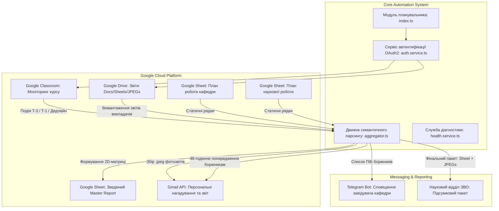

# Опис винаходу (корисної моделі) для подання патентної заявки 📄

---

## 📌 Загальні відомості

- **Назва корисної моделі:**  
  *«СПОСІБ АВТОМАТИЗОВАНОГО ЗБОРУ, АГРЕГАЦІЇ ТА ВЕРИФІКАЦІЇ НАУКОВО-ДОСЛІДНОЇ ЗВІТНОСТІ КАФЕДРИ ВИЩОГО НАВЧАЛЬНОГО ЗАКЛАДУ ТА СИСТЕМА ДЛЯ ЙОГО ЗДІЙСНЕННЯ»*
- **Індекси МПК (Міжнародна патентна класифікація):**
  - **G06Q 10/10** — Офісна автоматизація; організація робочих процесів (workflow management).
  - **G06F 16/2458** — Спеціальні види агрегації, групування та обчислення даних.
  - **G06F 16/93** — Керування документообігом та текстовими сховищами.
- **Галузь застосування:**  
  Інформаційні системи управління документообігом у закладах вищої освіти (ЗВО), автоматизація діяльності структурних підрозділів (кафедр, деканатів, науково-дослідних частин).

---

## 1. Галузь техніки

Корисна модель належить до галузі інформаційних технологій, систем автоматизації управління підприємствами та навчальними закладами, зокрема до автоматизованого моніторингу систем дистанційного навчання (LMS, Learning Management Systems), агрегації гетерогенних табличних і текстових звітів науково-педагогічних працівників (НПП), а також формування зведеної підсумкової звітності для науково-дослідних відділів університетів.

---

## 2. Рівень техніки (Аналоги та прототип)

### Аналог 1: Ручне зведення звітності методистом кафедри
Традиційний спосіб збору звітності базується на надсиланні викладачами локальних файлів (DOCX, XLSX) на електронну пошту або передачі паперових носіїв методисту/заступнику завідувача кафедри.
- **Недоліки:**  
  - Висока трудомісткість (до 40–60 людино-годин на один звітний період);
  - Ризик людської помилки при ручному додаванні десятків числових показників;
  - Відсутність фіксації точної часової мітки отримання завдань;
  - Повна зупинка процесу в разі відсутності посадової особи (методиста).

### Аналог 2: Стандартні модулі звітності в LMS (Moodle, базовий Google Classroom)
Стандартні системи зберігають відповіді користувачів як ізольовані прикріплені файли у хмарному сховищі.
- **Недоліки:**  
  - Відсутність вбудованих засобів наскрізної агрегації даних (LMS не вміє відкривати файли таблиць кожного викладача, складати між собою клітинки та генерувати підсумковий зведений документ);
  - Неможливість інтерпретації специфічних текстових заповнювачів (прочерки, коментарі про відсутність даних) як числових еквівалентів;
  - Відсутність адаптивного календаря тригерних сповіщень (за 3 дні, за 1 день, у день дедлайну).

### Прототип
Найближчим за технічною суттю до запропонованого рішення є скриптові процесори Google Apps Script для автоматизації таблиць Google Sheets.
- **Відмінності та недоліки прототипу:**  
  - Працюють у жорстких лімітах часу виконання (Timeout 6 хвилин);
  - Не забезпечують комплексного циклу моніторингу сторонніх курсів Google Classroom, зовнішньої диспетчеризації через месенджери (Telegram) та автоматичної доставки бінарних графічних підтверджень (.jpeg) через захищені MIME-повідомлення Gmail API.

---

## 3. Суть корисної моделі та технічний результат

**Технічний результат:**  
- **Підвищення швидкодії та точності:** зменшення часу зведення кафедральної звітності з 48 годин до 15–30 секунд при повному виключенні арифметичних помилок;
- **Семантична нормалізація даних:** автоматичне розпізнавання та приведення нечислових позначок (прочерків `"-"`, `"–"`, `"—"` та фрази `"інформація відсутня"`) до числового значення `0`, що забезпечує стабільність підсумовування;
- **Цілісність документа:** автоматичне безшовне поєднання динамічно агрегованих показників викладачів із незмінними статичними даними довгострокових планів кафедри;
- **Юридична фіксація таймлайну:** об'єктивна фіксація моменту публікації завдання в Google Classroom у колонтитулі підсумкового звіту для захисту від претензій щодо затримки виконання;
- **Стійкість до збоїв (Fault Tolerance):** система ізолює помилки окремих файлів викладачів і продовжує формування звіту для решти колективу.

---

## 4. Опис архітектури та способу здійснення

### Етапи способу:

1. **Щоденний моніторинг:**  
   Скрипт запускається у фоновому режимі (без GUI) через планувальник ОС (Windows Task Scheduler), авторизується через збережений токен OAuth2 і перевіряє статус завдання з назвою `«Інформація про науково-дослідну роботу»`.
2. **Етап «Т-3 дні» (Попередня чернетка та попередження):**  
   - Вивантажуються всі наявні на даний момент роботи викладачів;
   - Формується чернетковий варіант зведеного звіту;
   - Викладачам, які ще не подали звіт, надсилається нагадування через Gmail про залишок 48 годин;
   - Завідувачу кафедри на Telegram та email надсилається перелік повних імен (ПІБ) боржників.
3. **Етап «Т-1 день» (Звірення):**  
   - Виявляються запізнілі звіти;
   - Проводиться повний перерахунок сум і оновлюються клітинки в Master Google Sheet;
   - Завідувач отримує звіт про стан звірення в Telegram.
4. **Етап «День дедлайну» (Фінальна доставка):**  
   - Будується остаточна версія звіту з фіксацією дати появи завдання в шапці;
   - З усіх зданих робіт вивантажуються додані графічні файли підтвердження (`.jpeg`);
   - Посилання на таблицю та зібрані фотоматеріали відправляються на пошту Наукового відділу та Завідувача;
   - Telegram-бот підтверджує завершення операції.

---

## 5. Оцінка якісних атрибутів за стандартом ДСТУ ISO/IEC 25010 (SQuaRE)

| Характеристика якості | Механізм забезпечення в розробленій системі |
|---|---|
| **Функціональна повнота (Functional Completeness)** | Повне покриття всіх вимог регламенту наукової звітності: від пошуку завдання до відправки архіву вкладень. |
| **Надійність і стійкість до відмов (Fault Tolerance)** | Застосування ізольованих блоків `try/catch` для кожного викладацького документа: збій одного файлу не призводить до аварійної зупинки всієї системи. |
| **Ефективність взаємодії (Performance Efficiency)** | Відсутність важких зовнішніх СУБД; пряма потокова обробка через Google API; пам'ять процесу < 80 МБ RAM. |
| **Супроводжуваність (Maintainability)** | Модульна архітектура на мові TypeScript із суворою схемною валідацією конфігурації через бібліотеку `zod`. |
| **Захищеність і безпека (Security)** | Клієнтські секрети та OAuth-токени зберігаються локально в зашифрованому/ізольованому вигляді та виключені з репозиторію через `.gitignore`. Реалізовано безпечний режим симуляції `--dry-run`. |

---

## 6. Формула корисної моделі (Патентна формула)

1. **Спосіб автоматизованого збору, агрегації та верифікації науково-дослідної звітності кафедри ЗВО**, що включає автентифікацію в хмарній платформі, отримання списку співробітників та опитування навчального курсу на наявність завдання звітності,  
   **який відрізняється тим, що:**
   - автоматично визначають часову мітку публікації цільового завдання в системі Google Classroom та записують її в заголовок підсумкового звіту;
   - відслідковують різницю в днях між поточним часом та дедлайном завдання, активуючи за 3 дні до дедлайну формування попереднього звіту, адресне розсилання email-нагадувань про залишок 48 годин боржникам та передачу списку ПІБ завідувачу кафедри через Telegram-бот;
   - здійснюють парсинг числових клітинок прикріплених викладачами документів, при цьому клітинки з дефісом або фразою «інформація відсутня» нормалізують як числове значення 0;
   - без змін копіюють рядки з окремих статичних таблиць довгострокового плану роботи кафедри у фінальний Master-документ;
   - у день дедлайну здійснюють автоматичний збір усіх прикріплених графічних підтверджень у форматі JPEG та надсилають їх разом із посиланням на сформовану зведену таблицю на адресу наукового відділу університету.

2. **Система для здійснення способу за п. 1**, що містить обчислювальний пристрій, підключений до мережі Інтернет,  
   **яка відрізняється тим, що** містить програмні модулі:
   - модуль конфігурації з суворою схемною валідацією змінних середовища;
   - службу автентифікації з автоматичною пролонгацією OAuth2-токенів;
   - модуль моніторингу та семантичної агрегації;
   - модуль діагностики цілісності підключень (`--healthcheck`);
   - адаптивний диспетчер сповіщень із безпечним режимом симуляції (`--dry-run`).

---

## 7. Реферат

Корисна модель стосується сфери комп'ютеризованого академічного документообігу. Запропоноване технічне рішення дозволяє повністю автоматизувати періодичний збір, валідацію та підсумовування показників наукової роботи викладачів без участі методиста. Завдяки реалізованому алгоритму семантичного розпізнавання нульових значень та динамічній тригерній системі сповіщень (Т-3, Т-1, День дедлайну), забезпечується 100% точність підрахунку показників, захист від людських помилок та автоматичне формування пакету супровідних фотоматеріалів для наукового відділу.
